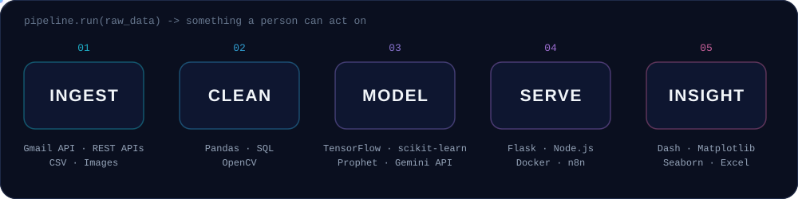
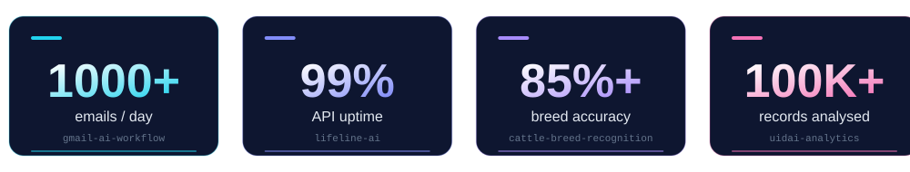

 

## 🧾 Model Card

| | |
| :-- | :-- |
| **🧠 Base model** | B.Tech in Information Technology @ Panipat Institute of Engineering & Technology *(2024–2028)* |
| **🎛️ Fine-tuned on** | Business Intelligence using AI Analytics internship @ Revolt Motors *(Jul–Aug 2026)* + independent projects |
| **🎯 Intended use** | Turning messy data into decisions: ML models, analytics dashboards and workflow automation |
| **🧰 Core stack** | Python · SQL · C++ · TensorFlow · scikit-learn · Flask · n8n |
| **📍 Deployed in** | Haryana, India |
| **🟢 Status** | Open to AI/ML and Data Analytics internships |

## ⚙️ Architecture

Most of what I build follows one flow, from raw input to something a person can act on. Each stage below is a tool I've actually used.

## 📈 Evaluation

### 🧪 Experiment log

| # | Experiment | Stack | Outcome |
| :-: | :-- | :-- | :-- |
| 01 | [**Gmail AI Workflow**](https://github.com/Mr-rxa/gmail-ai-workflow) | n8n · Gemini API · Gmail API · Node.js | Classifies, summarizes and labels **1000+ emails a day**; about **70%** less manual sorting |
| 02 | [**Lifeline AI**](https://github.com/Mr-rxa/Lifeline-AI) | Python · Flask · Dash · REST | AI health-guidance platform with a live dashboard; **99% uptime**, **sub-200 ms** responses |
| 03 | [**Cattle Breed Recognition**](https://github.com/Mr-rxa/cattle-breed-recognition) | TensorFlow · MobileNetV2 · OpenCV | **85%+ accuracy** on **5000+** augmented images; **40%** faster inference |
| 04 | [**UIDAI Data Analytics**](https://github.com/Mr-rxa/UIDAI) | Python · Pandas · Matplotlib · Seaborn | Insights from **100K+ records**, visualised for non-technical readers |
| 05 | [**AI Retail War Room**](https://github.com/Mr-rxa/AI-Retail-War-Room) | Flask · Prophet · scikit-learn · Gemini | Retail forecasting and a What-If simulator, from my Revolt Motors internship |

## 🔬 Currently training

- 🏛️ **AI Procurement Intelligence Platform:** a transparency system for public tenders with risk indicators, contractor integrity scoring and explainable outputs. It deliberately surfaces *statistical signals* instead of accusations. *(design and documentation phase)*
- 📈 **Yes Bank stock closing-price prediction:** a regression capstone

## 🏅 Training data

<b>Certifications</b> (click to expand)

 

| Certification | Issuer | Date |
| :-- | :-- | :-- |
| Git & GitHub | Spoken Tutorial, IIT Bombay | Dec 2025 |
| Tata Cybersecurity Analyst Job Simulation | Forage | Oct 2025 |
| Deloitte Technology Job Simulation | Forage | Sep 2025 |
| C++ Programming | Sololearn | Jul 2025 |
| Deloitte Data Analytics Job Simulation | Forage | May 2025 |
| C Programming | Spoken Tutorial, IIT Bombay | Dec 2024 |
| H4CKP13T 0X01 CTF (Cybersecurity Competition) | H4CKP13T-PIET | Aug 2024 |

## ⚠️ Limitations

Early-career, so I'm strongest where I can learn on real problems. I'm looking for an AI/ML or data analytics internship with real data and good mentors.

## 📬 Inference endpoint

Best reached on [LinkedIn](https://linkedin.com/in/rahul-sharma-825894237) or at [sharmarahul5437@gmail.com](mailto:sharmarahul5437@gmail.com).

*"Building things that make life a little smarter, one commit at a time."*

