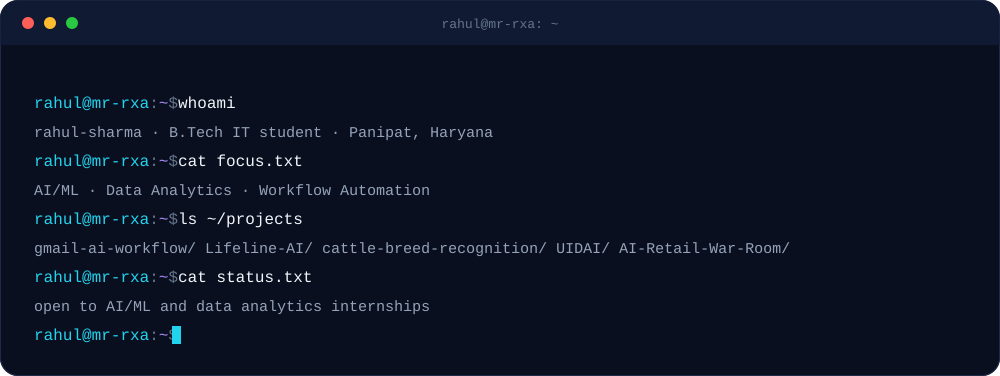
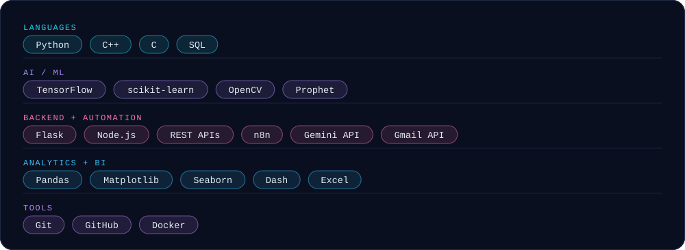
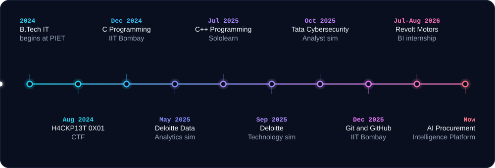

<div align="center">


<br/>

[](https://linkedin.com/in/rahul-sharma-825894237)
[](mailto:sharmarahul5437@gmail.com)
[](#)

<br/>

**I love turning complex problems into elegant, automated solutions.**

</div>

<br/>


<br/>



<br/>

### 🧾 Model card

| | |
| :-- | :-- |
| **🧠 Base model** | B.Tech in Information Technology @ Panipat Institute of Engineering & Technology *(2024–2028)* |
| **🎛️ Fine-tuned on** | Business Intelligence using AI Analytics internship @ Revolt Motors *(Jul–Aug 2026)* plus independent projects |
| **🎯 Intended use** | Turning messy data into decisions: ML models, analytics dashboards and workflow automation |
| **📍 Deployed in** | Haryana, India |
| **🟢 Status** | Open to AI/ML and Data Analytics internships |

### 💬 Ask me about

- 🤖 Building **n8n + Gemini API** automation workflows
- 🧪 Fine-tuning **MobileNetV2** for image classification with TensorFlow
- 🌐 Shipping **Flask** backends, REST APIs and **Dash** dashboards
- 📊 **BI dashboards and reports** in Excel, plus forecasting with Prophet

<br/>


<br/>



<br/>



<br/>

Most of what I build follows one flow, from raw input to something a person can act on. Each stage lists tools I've actually used.


<br/>


<br/>


<br/>

### 📧 [Gmail AI Workflow](https://github.com/Mr-rxa/gmail-ai-workflow)

> *n8n · Gemini API · Gmail API · Node.js*

- **What it does:** an email automation agent that classifies, summarizes and labels incoming Gmail using AI-driven workflows
- **Highlights:** handles **1000+ emails a day** and cuts manual sorting time by about **70%** through automated categorization and routing

### 🏥 [Lifeline AI](https://github.com/Mr-rxa/Lifeline-AI)

> *Python · Flask · Dash · REST APIs*

- **What it does:** a full-stack health-guidance platform with an AI-powered backend, a Dash dashboard for real-time analytics and a RESTful API
- **Highlights:** **99% uptime** and **sub-200 ms** response times

### 🐄 [Cattle Breed Recognition](https://github.com/Mr-rxa/cattle-breed-recognition)

> *TensorFlow · MobileNetV2 · Python · OpenCV*

- **What it does:** an image classifier that identifies cattle breeds, fine-tuned from MobileNetV2
- **Highlights:** **85%+ accuracy**, **5000+** training images preprocessed and augmented, and an inference pipeline optimized to cut prediction latency by **40%**

### 📊 [UIDAI Data Analytics](https://github.com/Mr-rxa/UIDAI)

> *Python · Pandas · Matplotlib · Seaborn · ML*

- **What it does:** an analytics solution that extracts insights for digital-identity optimization
- **Highlights:** processes **100K+ records** and presents the patterns through interactive visualizations that non-technical stakeholders can read

### 🏍️ [AI Retail War Room](https://github.com/Mr-rxa/AI-Retail-War-Room)

> *Flask · Prophet · scikit-learn · Gemini*

- **What it does:** a retail analytics and forecasting web platform with a What-If simulator, built during my Revolt Motors internship with AI-assisted tools
- **My role:** requirements, testing, BI interpretation, and fixing latency in the What-If simulator

<br/>



<br/>

### 🏢 Business Intelligence using AI Analytics Intern, Revolt Motors

*1 Jul – 9 Aug 2026 · six weeks*

- 📉 **Open Complaint Dashboard:** built in Excel with pivot tables and slicers
- 🗂️ **EOD Report:** consolidated booking, retail and stock data into one daily report, the largest share of my work
- 🏍️ **AI Retail War Room:** a forecasting platform, described above

<br/>


<br/>

### 🏛️ AI Procurement Intelligence Platform

A public-procurement transparency system for governments, auditors, vigilance departments, journalists and citizens.

- **Capabilities:** procurement risk assessment, contractor integrity scoring, cost estimation, budget flow tracking, tender intelligence and explainable AI outputs
- **Design principle:** surface *statistical risk indicators* instead of making direct accusations
- **Process:** following a structured enterprise documentation workflow, with these documents done so far:

```text
BRD → MRD → PRD → TRD → SRS → HLD → LLD ✓
```

### 📈 Yes Bank stock closing-price prediction

A regression capstone project on Yes Bank stock data.

<br/>


<br/>



<br/>


<br/>

| Certification | Issuer | Date |
| :-- | :-- | :-- |
| Git & GitHub | Spoken Tutorial, IIT Bombay | Dec 2025 |
| Tata Cybersecurity Analyst Job Simulation | Forage | Oct 2025 |
| Deloitte Technology Job Simulation | Forage | Sep 2025 |
| C++ Programming | Sololearn | Jul 2025 |
| Deloitte Data Analytics Job Simulation | Forage | May 2025 |
| C Programming | Spoken Tutorial, IIT Bombay | Dec 2024 |
| H4CKP13T 0X01 CTF (Cybersecurity Competition) | H4CKP13T-PIET | Aug 2024 |

<br/>


<br/>

I'm looking for **AI/ML and Data Analytics internships** where I can work on real data and learn from good mentors.

| | |
| :-- | :-- |
| 💼 **LinkedIn** | [rahul-sharma-825894237](https://linkedin.com/in/rahul-sharma-825894237) |
| ✉️ **Email** | [sharmarahul5437@gmail.com](mailto:sharmarahul5437@gmail.com) |
| 🐙 **GitHub** | [@Mr-rxa](https://github.com/Mr-rxa) |

<br/>


